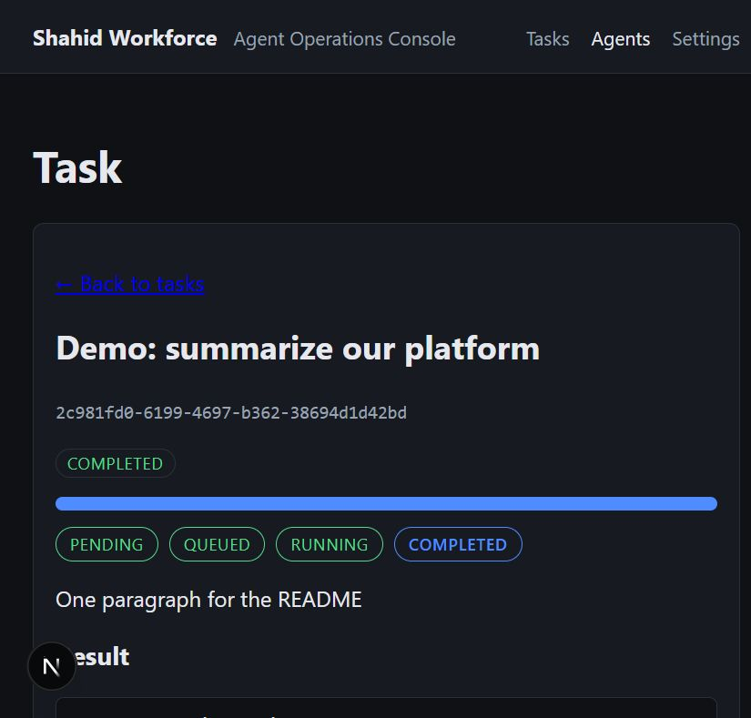
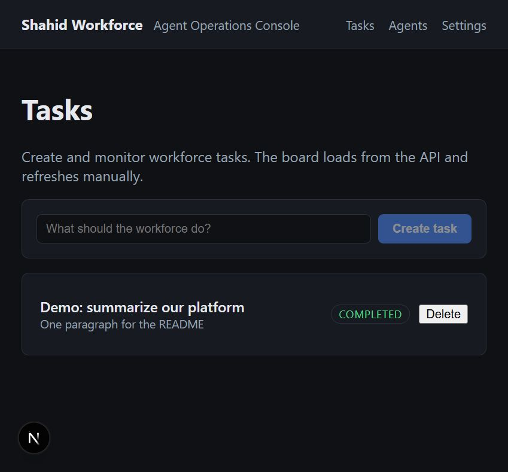
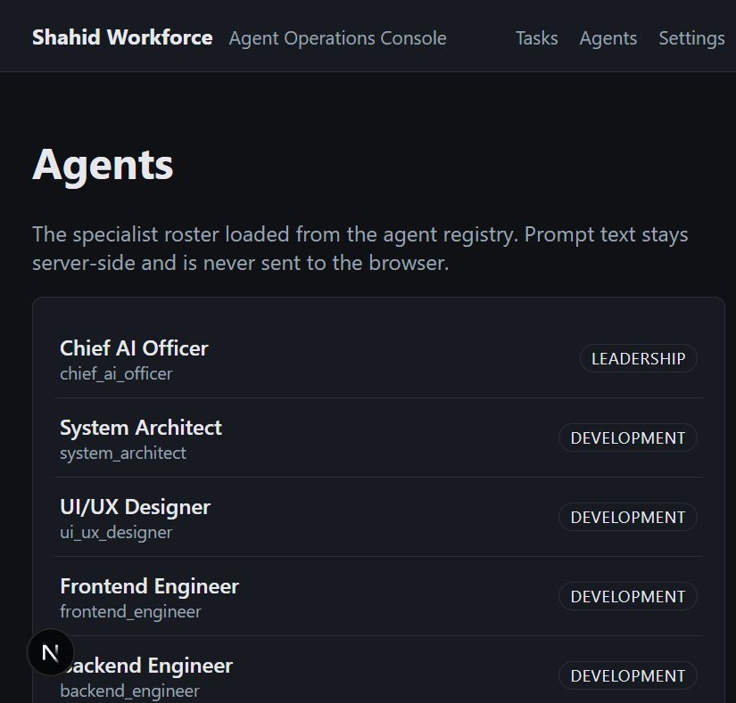
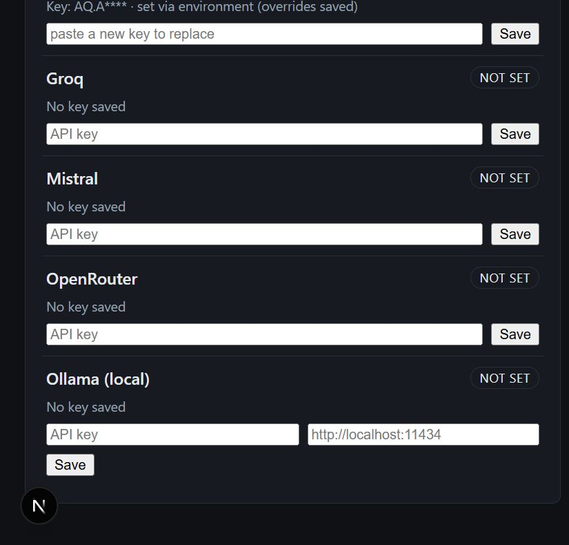

# Shahid Assistant AI

[](https://github.com/shahid-boop/shahid-workforce/actions/workflows/ci.yml)
<a href="https://trendshift.io/repositories/82054?utm_source=repository-badge&amp;utm_medium=badge&amp;utm_campaign=badge-repository-82054" target="_blank" rel="noopener noreferrer"></a>

Windows 11 desktop AI assistant with a multi-agent AI workforce: create a
task, a supervised chain of specialist AI agents plans, executes and
reviews it — with a local dashboard to drive everything.

## Screenshots

| Task board | Task detail & progress |
|---|---|
|  |  |

| Agents roster | Settings (provider keys) |
|---|---|
|  |  |

## Features

### Multi-agent workforce
- **15 specialist agents** across Leadership, Development, Quality &
  Security, Infrastructure and Intelligence (`agents/`, stable IDs).
- **LangGraph supervisor** routes every goal through a plan of sequential
  specialist steps, each receiving prior outputs as reviewable context.
- **Mandatory quality gates**: every plan ends with independent
  `code_reviewer` and `qa_engineer` steps.
- **Key-less determinism**: with no provider key the run falls back to
  template output, so the whole pipeline works before any signup.

### Real LLM connection — provider-agnostic, free tiers first
- **LiteLLM-backed** calls for **7 providers**: Google Gemini, Groq,
  OpenRouter, Mistral, OpenAI, Anthropic and Ollama (local).
- **Verified free-tier default chain** (`gemini-3.6-flash` → flash-lites →
  Groq → OpenRouter `:free`), fully overridable via
  `WORKFORCE_MODEL_PRIMARY` / `WORKFORCE_MODEL_FALLBACKS`.
- **Fallback & rotation** on rate limits, timeouts, auth and 5xx errors;
  request-shape errors abort immediately. API keys are redacted from every
  error message and never logged.
- **Budget preflight**: estimate-based per-task spend ceiling with a price
  table before the first call.
- **Ollama**: no key needed — a base URL alone enables the local daemon.

### Manual key management (no terminal)
- **Settings page** (`/settings`): paste, save and remove keys for every
  provider from the browser — Groq, OpenRouter, Gemini, Ollama, …
- Keys are stored server-side in the `provider_credentials` table and
  returned only as a **masked prefix** (`gsk-****`); environment variables
  always override stored keys. Changes apply to the next task — no restart.

### Task lifecycle & auto-run
- `POST /tasks` → **auto-executes inline in development** (no Redis, no
  worker process) through the real LLM chain and writes the result back.
- Production/queued mode uses the RQ worker (`services/workers`) with
  retries; `WORKFORCE_AUTO_RUN=0/1` switches modes.
- Task statuses: pending → queued → running → completed/failed/cancelled,
  with live polling from the dashboard.

### Dashboard (Next.js)
- **Tasks**: create, list with status badges, delete, detail view with a
  progress pipeline and 3s auto-refresh while running.
- **Agents**: read-only roster (prompt text never leaves the server).
- **Settings**: provider key management (above).
- The API key **never reaches the browser in dev** (server-side `/api`
  proxies); in the packaged static build it is injected at serve time and
  attached by `apiFetch`.

### One-click local development
- **`start-dev.bat`** (Windows): creates `.venv`, installs deps, runs
  migrations, starts API + dashboard, opens the browser. Tasks auto-run.

### Security
- Fail-closed production auth (`X-API-Key`, constant-time compare),
  security headers, explicit CORS allowlist.
- **GitHub tool is read-only** with token scrubbing from all output;
  terminal runs a fixed-argv allowlist (no shell); filesystem tool is
  jailed against path traversal.
- Docker **sandbox** for code execution: no network, read-only, non-root.

### Operations
- Alembic migration pipeline with ORM drift tests.
- Docker Compose stack (api/worker/redis/dashboard), monitoring hooks and
  structured logging (`infrastructure/`).

### Quality
- **300 tests** (unit, integration, security, e2e, docs regressions) and
  a 2-job CI (Python: ruff + mypy + pytest; Dashboard: tsc + build +
  static export).
- No feature ships until its tests pass in CI.

## Installation & setup

Three ways to run it — pick whichever is easiest for you.

### Option A — Windows EXE (no Python, no Node, easiest)

1. Download **`ShahidWorkforce-win64.zip`** from the
   [Releases page](../../releases).
2. Extract the zip anywhere (Desktop, `C:\Program Files\ShahidWorkforce`, …).
3. Double-click **`ShahidWorkforce\ShahidWorkforce.exe`**.
4. A console window opens and the dashboard starts automatically at
   **http://127.0.0.1:8756** (your browser opens by itself).

That's it — no installers, no terminal. The EXE ships the API + dashboard
in one process and:

- creates its database and a generated API key under
  `%LOCALAPPDATA%\ShahidWorkforce` on first launch (persists between runs);
- executes tasks inline automatically (no Redis/worker needed);
- stop the app by closing its console window.

> **Optional:** set provider keys from the **Settings** page in the
> browser (see [Add an LLM key](#add-an-llm-key-no-terminal-needed)) —
> no terminal required.

### Option B — from source with one script (Windows)

1. Install [Python 3.12+](https://www.python.org/downloads/) and
   [Node.js 22+](https://nodejs.org/) (tick **"Add to PATH"** in the
   Python installer).
2. Clone and run the starter:

```bat
git clone https://github.com/shahid-boop/shahid-workforce.git
cd shahid-workforce
start-dev.bat
```

`start-dev.bat` creates `.venv`, installs dependencies, runs database
migrations, starts the API (`:8000`) + dashboard (`:3000`) and opens the
browser. Tasks auto-run in development — no Redis required.

### Option C — manual terminal setup (Windows / macOS / Linux)

```bash
# 1. Clone
git clone https://github.com/shahid-boop/shahid-workforce.git
cd shahid-workforce

# 2. Python environment + dependencies
python -m venv .venv
# Windows:   .venv\Scripts\activate
# macOS/Linux: source .venv/bin/activate
pip install -e ".[dev]"

# 3. Database migrations (SQLite by default)
alembic upgrade head

# 4. Start the API
export WORKFORCE_API_KEY=local-dev-key      # Windows PowerShell: $env:WORKFORCE_API_KEY="local-dev-key"
python -m uvicorn services.api.main:app --host 127.0.0.1 --port 8000

# 5. In a second terminal: start the dashboard
cd apps/dashboard
npm ci
npm run dev                                  # http://localhost:3000
```

Open **http://localhost:3000** — the dashboard talks to the API on
`:8000`. Full details, Docker stack and production notes:
[`docs/setup.md`](docs/setup.md).

### Add an LLM key (no terminal needed)

Tasks run with a key-less template fallback out of the box. For **real
LLM output**:

1. Open **Settings** in the dashboard (`/settings`).
2. Paste a key for any provider and hit **Save** — e.g. a free
   [Google AI Studio](https://aistudio.google.com/apikey) Gemini key,
   a free [Groq](https://console.groq.com/keys) key, or an OpenRouter key.
3. Create a task — it executes immediately with the real model chain
   (Gemini free tier → Groq → OpenRouter `:free` fallbacks). No restart.

Keys are stored server-side, shown only as a masked prefix, and can be
removed with **Remove** at any time. Advanced users can instead set
`WORKFORCE_GEMINI_API_KEY` / `WORKFORCE_GROQ_API_KEY` / … environment
variables (they override saved keys) — see `docs/setup.md`.

### Run your first task

1. On the **Tasks** page, type a goal: *"Summarize this repo's README
   in 3 bullet points"* → **Create task**.
2. The task auto-runs: a supervisor plans specialist steps, agents
   execute them, `code_reviewer` + `qa_engineer` gates run at the end.
3. Open the task to watch the live progress pipeline; the result appears
   when the status turns **completed**.

## Repository structure

```
Shahid-Assistant-AI/
├── apps/dashboard/       # Dashboard web app (routes, components, features, hooks, lib)
├── services/
│   ├── api/              # FastAPI service (routes, middleware, auth, /api mirrors)
│   ├── orchestrator/     # Task supervisor, LangGraph, routing, state
│   ├── model_router/     # Provider routing, fallback, budgets, LiteLLM
│   └── workers/          # Task worker and scheduler
├── agents/               # Agent registry, base agent, prompts/, configs/agents.yaml
├── tools/                # github, filesystem, terminal, browser, database, testing
├── sandbox/              # Dockerfile and execution policies
├── database/             # migrations, models, repositories
├── infrastructure/       # docker, deployment, monitoring, redis
├── tests/                # unit, integration, security, e2e
├── docs/                 # architecture, agents, setup, security, deployment
└── .github/workflows/    # CI
```

## Status

Incremental build-out (each step ships with tests and a green CI):

- ✅ `services/api` - health + task CRUD + agent roster with API-key auth (fail-closed)
- ✅ `agents/` - registry, prompt loading, shared agent interface
- ✅ `services/orchestrator` - routing, supervisor, LangGraph task graph
- ✅ `apps/dashboard` - Next.js console: task board, task detail/progress, agents page, `/api` proxy routes
- ✅ `services/model_router` - 7 providers, budgets, fallback with billing preflight; **real LLM calls via LiteLLM with free-tier defaults** (key-less runs fall back to templates)
- ✅ Dashboard **Settings page** (`/settings`) - manually save/remove provider keys (Gemini, Groq, OpenRouter, Ollama, ...), stored server-side and returned only masked
- ✅ **Dev auto-run** - `POST /tasks` executes inline via `BackgroundTasks` (no Redis in development; `WORKFORCE_AUTO_RUN` override)
- ✅ **Static export** - `npm run build:static` produces a fully static dashboard served by FastAPI itself (`WORKFORCE_DASHBOARD_DIR`) with runtime key injection — the packaged single-process mode
- ✅ `start-dev.bat` - one-click Windows dev starter (venv + migrations + both servers + browser)
- ✅ `services/workers` - scheduler (memory + Redis) and task worker with retries
- ✅ `tools/` - filesystem (jailed), terminal, database, github, testing, browser
- ✅ `sandbox/` - hardened Docker execution policy with local opt-in
- ✅ `database/migrations` - Alembic pipeline with ORM drift tests
- ✅ `infrastructure/` - compose stack (api/worker/redis/dashboard), monitoring, logging
- ✅ `tests/` - security regressions (auth, headers, jail, scrub) + e2e full flow (API→worker→orchestrator)
- ✅ `docs/` - architecture, setup, security, deployment, agents (with regression tests)
- ✅ **Windows EXE release** - PyInstaller onedir build + GitHub Actions release workflow with smoke test (`packaging/`, `.github/workflows/release.yml`)

No feature is considered working until its tests pass in CI.

## Requirements

- Python 3.12+
- Node.js 22+
- Docker (for the code sandbox)
- Redis + PostgreSQL (for queued tasks and hosted persistence)

## Security

See [docs/security.md](docs/security.md). Never commit secrets or populated
`.env` files.
